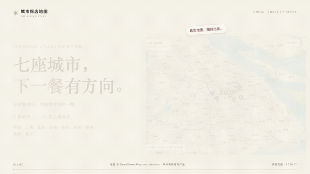

# 城市探店地图

七座城市、十张地图。首页按国家分组，中国在前（上海、北京、苏州、南京、杭州、香港），韩国在后（首尔）。提供七城米其林地图，以及上海餐饮总览、必吃榜×扫街榜、酒吧×Livehouse。全部采用统一的纸色地图与名录布局，支持筛选、本机收藏、距离排序、分享和手机地图/名录切换。

线上入口：[城市探店地图](https://frankjie09.github.io/shanghai_map_pages/)。修改源文件后需要构建并通过现有 GitHub Pages 工作流发布；本地预览不代表线上已经更新。

## 收录范围

| 城市 / 专题 | 指南版本 | 名录记录 | 已定位点位 |
| --- | --- | ---: | ---: |
| 首尔米其林 | 2026 | 93 | 93 |
| 上海米其林 | 2026 沪苏浙 | 86 | 86 |
| 北京米其林 | 2027（2026-10-27 发布） | 65 | 65 |
| 苏州米其林 | 2026 沪苏浙 | 21 | 21 |
| 南京米其林 | 2026 沪苏浙 | 25 | 25 |
| 杭州米其林 | 2026 沪苏浙 | 47 | 46 |
| 香港米其林 | 2026 香港澳门（仅香港） | 147 | 146 |
| 上海餐饮总览 | 三榜合并 | 131 | 131 |
| 上海必吃榜 × 扫街榜 | 已公开可核实部分 | 58 | 58 |
| 上海酒吧 × Livehouse | 含停业历史记录 | 37 | 37 |

香港保留官方港币消费档位（`$` 至 `$$$$`），不换算人民币。潮樂園当前官网缺页，保留为未定位年度记录；香港的区域筛选沿用官方香港島、九龍西等片区标签，不将其称为18个法定行政区。

米其林地图只收录星级餐厅与必比登推介，不含仅“入选餐厅”。每城版次独立，不把已发布的北京2027版错误改为2026版。绿星为独立荣誉，不重复计数。年度“新获奖 / 晋级”不等于新开业。

杭州的好食堂1987（文三路）在2026发布名单中，但当前官方详情页已失效，无法核实坐标。它保留在名录并明确标记，不画虚构点位、不计算虚假距离、不提供精确导航。上海原年度名单中的望庐（浦东）、壹零贰小馆、阿娘面也标明当前官方目录未找到；其既有位置与历史说明保留，不能仅凭目录缺页判定停业。

2026-11-16核验新城市官方目录与逐店资料；日期和证据见 `data/guide-metadata.json` 与 `data/guides/`。上海新增83条匹配到官方中文门店的详情链接。必吃榜、扫街榜及夜生活继续保留2026-09-12原核实信息，没有因改版而冒称全量更新营业状态。

## 构建与预览

```bash
python3 scripts/validate_data.py
python3 build.py
python3 build.py --check
python3 -m http.server 8876 --bind 127.0.0.1
# 打开 http://127.0.0.1:8876/dist/index.html
```

也可运行 `./render.sh`。页面是自包含HTML，数据、Leaflet、样式与脚本在构建时内联，无运行时JS/CSS CDN或密钥。离线可查资料与名录，OpenStreetMap底图和外部导航需要联网。

`dist/` 是提交到仓库的构建产物，不要手工改里面的数据。根目录 `index.html` 只负责转到 `dist/index.html`。构建manifest用于检查产物是否与源一致。

## 维护位置

| 文件 | 用途 |
| --- | --- |
| `data/atlas-pages.json` | 十图配置：国家、城市、币种、版本、标题、底图中心、地标、数据源、输出文件与预期记录数 |
| `data/venues/*.json` | 各榜单的原始门店数据 |
| `data/guide-metadata.json` / `data/guides/*.json` | 官方来源、核验范围、年度数量及未定位条目 |
| `src/pages/index.html` | 按国家分组的七城与上海专题入口 |
| `src/pages/*-michelin.html`、上海四页模板 | 轻量入口，内联本图配置和数据 |
| `src/partials/dining-atlas.html` | 十张地图的共享页面结构 |
| `src/static/dining-atlas.css` / `dining-atlas.js` | 共用布局、地图、筛选、详情与收藏 |
| `src/static/venue-links.js` | 中国城市百度检索、导航及移动App回落 |
| `scripts/merge_venues.py` | 上海三榜合并 |
| `scripts/validate_data.py` | 坐标、字段、指南统计和城市配置校验 |

中国城市的百度导航显式传 `coord_type=wgs84`，按当前城市设置region，支持手机App调起与网页回落。香港额外提供Google地图检索，首尔使用Naver、Kakao、Google地图和韩文地址。收藏按地图独立保存；首尔沿用已有收藏键。上海旧 `#v=<key>` 深链继续有效，新城市使用 `#r=<id>`。

上海仍可叠加既有13条地铁线路与87个站点的核心区参考图层，默认关闭；它不是全市完整地铁网。6号线因原数据范围未覆盖而不在图层中。

## 新城市资料更新

```bash
python3 scripts/import_beijing_michelin.py --help
python3 scripts/import_jiangsu_michelin.py --help
python3 scripts/import_hangzhou_michelin.py --help
python3 scripts/import_hong_kong_michelin.py --help
```

导入脚本从米其林公开官方目录和逐店JSON-LD获取数据，可使用缓存重跑。保留指南发布版与实时目录的区别；遇到缺失记录应写明证据和状态，不补猜测坐标。更新独立指南后同步 `guide-metadata.json` 对应城市，再运行校验与构建。

上海总览按两个数据源坐标完全一致去重，目前58 + 86 − 13 = 131。不要用近似店名或相邻坐标强行合并。米其林侧没有具体人均时保留“人均待核实”，不将¥档位换算成人民币金额。

## 浏览器验收

```bash
python3 scripts/atlas_probe.py   # 十张图与国家首页，真实窄屏/宽屏布局与核心行为
python3 scripts/seoul_probe.py   # 首尔兼容性回归
```

探针使用独立Chrome profile，不污染日常浏览器收藏。自动发现macOS/Linux Chrome，也可指定 `CHROME`。检查计数、筛选、收藏、深链、中国导航坐标及region、未定位记录和横向溢出。底图请求在探针中屏蔽以验证离线核心功能；联网底图另做可视检查。系统定位、实际App打开与系统分享权限不由探针代用户确认。

旧手绘底图、Tailwind、移动抽屉和相关探针仅保留为历史实现，详见 [旧版实现记录](docs/legacy-shanghai-implementation.md)。当前页面不依赖旧 `map-base.js`、`mobile-shell.js`、`mobile.css` 或 `atlas-layout.css`。

## 24 秒看懂七城探店地图

中国在前，韩国在后。从上海的新地图，到北京、苏州、南京、杭州与香港，再到首尔，用真实页面展示七城十图。

https://github.com/user-attachments/assets/43bba7f0-23f8-44f2-9da0-11b288eb7774

[下载高清 MP4（1080p · 24 秒）](docs/media/shanghai-map-promo.mp4?raw=true)

<details>
<summary>查看无声动图预览</summary>



</details>
